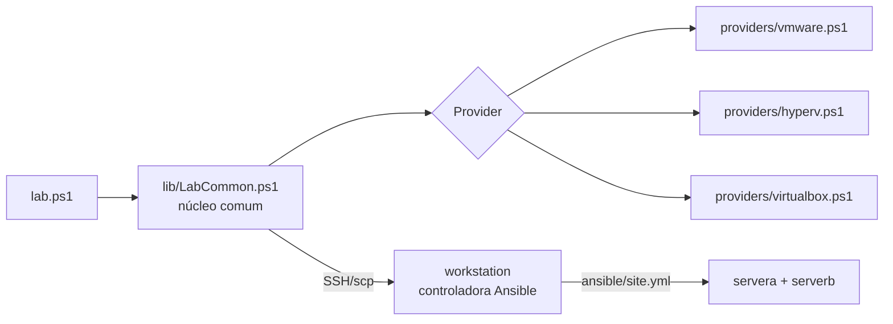

# Providers do `infra/`: as VMs direto no hypervisor do host

Como o `infra/` sobe o mesmo lab do backend KVM em VMware Workstation,
VirtualBox e Hyper-V, e por que foi desenhado assim. Valores exatos:
[referência do `lab.ps1`](../reference/lab-ps1.md) e
[configuração](../reference/configuracao-infra.md).

## Objetivo: o mesmo lab, sem virtualização aninhada

O backend original precisa de KVM/libvirt. Fora do Linux, a alternativa
era uma VM Linux rodando o backend por dentro, com as 3 VMs aninhadas
([deploy-windows.md](../how-to/deploy-windows.md)). Funciona, mas custa uma
VM a mais, perde desempenho e conflita com outros hypervisors no Windows.

O `infra/` cria as 3 VMs **direto** no hypervisor do host. A regra de
design é não mexer no que roda dentro delas: o `ansible/site.yml`, os
roles, os exercícios, o comando `lab` e o dashboard são os mesmos, sem
cópia nem alteração. Só a criação das VMs muda.

## Núcleo comum + providers

Tudo o que independe do hypervisor fica no núcleo: tradução de IPs,
kickstart, SSH, cópia do repositório, provisionamento, ciclo de vida
(`stop`, `start`, `snapshot`, `reset`, `down`). Cada provider implementa o
mesmo contrato de ~20 funções (criar golden, clonar, ligar, desligar,
snapshot, ISO, endpoint de SSH), descrito em `infra/providers/README.md`.
Um provider novo é um arquivo novo, sem tocar no núcleo.

**Por que PowerShell 7?** Roda igual no Windows e no Linux, e no Windows
não exige instalar nada exótico. Um único código atende os dois sistemas.

**Por que Packer, se o README diz "sem Packer"?** A decisão do backend KVM
vale lá: o `virt-install` já está no host. Nos outros hypervisors não há
equivalente nativo e portável; o Packer é o mesmo binário para os três e
reaproveita o **mesmo** `kickstart/ks.cfg.tpl` e o **mesmo**
`image/finalize.sh`. As adaptações (trocar `poweroff` por `reboot` para o
Packer entrar por SSH, pacotes de integração, IP fixo no Hyper-V) são
aplicadas na renderização e falham alto se o template mudar.

## A workstation como controladora temporária

O Ansible não roda no Windows. Em vez de exigir WSL2 ou uma 4ª VM, o
`lab.ps1` usa a **workstation**: envia a cópia do repositório por `scp`,
instala o `ansible-core` a partir da ISO, roda o `site.yml` de lá contra as
3 VMs e, no fim, remove o `ansible-core` (que não existe na workstation do
homelab), a chave e os segredos.

O obstáculo: o role `common` reinicia cada VM para renomear as NICs para
`ens18`/`ens19`, e a controladora não pode reiniciar a si mesma no meio do
playbook. A solução é uma fase `prepare` que aplica antes, na workstation,
**os mesmos arquivos** que o role geraria (o próprio
`roles/common/tasks/network.yml`, com o reboot desligado por variável) e
deixa o reboot para o host. No `site.yml`, a tarefa não vê mudança na
workstation e não a reinicia.

As fases longas rodam via `systemd-run`, dentro da workstation: uma queda
do SSH do host (suspensão, Wi-Fi) não mata o playbook, e o `lab.ps1`
reconecta e continua acompanhando o log.

A ISO chega à workstation pelo **CD** da VM. O role `classroom` usa
`dnf --repofrompath`, que aceita `file://`, então o mirror lê a ISO montada
(`lab_iso_url=file:///mnt/rhcsa-lab-iso`), sem servidor HTTP no host.

## Tradução de IPs

Os exercícios usam endereços fixos da rede `192.168.56.0/24` (gateway
`.1`, VMs `.10/.20/.30`, o IP `.91` do `examsim-network`). Com Hyper-V e
VirtualBox o `infra/` cria uma rede dedicada com essa mesma faixa. Com
VMware no Windows isso nem sempre é possível: há **uma única rede NAT**, e
ela pode já estar em uso por outras VMs, com outra faixa.

O `ip-map.<provider>.yaml` resolve sem editar o repositório: a tradução é
aplicada em memória e na cópia enviada à workstation. O autor fez o mesmo
quando trouxe os exercícios do homelab (`192.168.10.x` → `192.168.56.x`).
A troca casa o octeto inteiro (`.1` nunca casa dentro de `.10`), e um
endereço sem tradução faz o `check` falhar, o que protege contra
exercícios novos do upstream.

## Rede: o papel do host libvirt

No backend KVM, o host libvirt é o gateway `.1`: roteia, faz NAT, é o
"DNS" e responde ping (o `examsim-network` confere). Cada provider
reproduz esse papel:

| Provider | Quem faz o papel | Como as VMs recebem o IP no 1º boot |
|---|---|---|
| `vmware` | o NAT do VMware | reservas DHCP por MAC no DHCP do VMware |
| `hyperv` | o próprio Windows (`New-NetNat`) | **não há DHCP** no switch interno: a golden traz um perfil de rede por MAC de gerência, já com o IP da VM; o role `common` apaga esses perfis e cria o `ens18`, como faz com o perfil da instalação nos outros backends |
| `virtualbox` | o VirtualBox (NAT Network) | DHCP com endereço fixo por MAC |

Detalhes que parecem estranhos e têm motivo:

- **Hyper-V, porta 53 liberada no firewall**: o Windows não é servidor
  DNS. Bloqueada, a consulta ao `.1` espera o timeout antes de passar para
  o `8.8.8.8`, a cada consulta. Liberada, o Windows responde "porta
  fechada" na hora.
- **VirtualBox, `127.0.0.1:2210-2212`**: a NAT Network não é roteável a
  partir do host; SSH e dashboard passam por redirecionamento de portas.
- **MACs do homelab (`bc:24:11`, do Proxmox)**: o VMware só aceita MACs
  estáticos da faixa dele com `checkMACAddress = FALSE` no `.vmx`. Manter
  os MACs mantém a renomeação `ens18`/`ens19` do role `common` igual.

## Discos

Os exercícios encontram os discos extra **pelo tamanho exato em bytes**,
nunca pelo nome (`lab-common.sh`). Por isso cada provider só precisa criar
os discos com o tamanho exato e na ordem do `machines.yaml`: a serverb fica
com `sdb` = 6 GiB e `sdc` = 1 GiB, como no homelab. Os clones são
vinculados (VMware, VirtualBox) ou diferenciais (Hyper-V): nascem em
segundos e só guardam as diferenças em relação à golden.

## Ciclo de vida e snapshots

O snapshot `pronto` é tirado no fim do provisionamento, **com as VMs
desligadas**. Um snapshot de VM ligada guardaria a memória e o `reset`
seria instantâneo, mas a VM voltaria com o relógio parado no momento do
snapshot, o que confunde exercícios de agendamento e de NTP.

O `down` **desregistra** cada VM da Red Hat antes de apagá-la: o lockdown
do projeto desliga os repositórios, mas deixa o registro, e ciclos
efêmeros acumulariam sistemas na conta.

Cada provider tem a sua golden e o seu lab (`<VmRoot>/golden/<provider>`,
`<VmRoot>/lab/<provider>`), para trocar de hypervisor sem apagar o outro.

## O que é testado

Cada provider declara em quais sistemas foi testado de ponta a ponta; o
`check` e o `setup-host.ps1` avisam nos demais. O código dos caminhos não
testados segue o mesmo contrato do testado (Windows + VMware) e foi
revisado, mas detalhes do hypervisor (sintaxe do `VBoxManage`, nome da
placa no instalador do Hyper-V, rede do VMware no Linux) só se confirmam
rodando. O status de cada caminho está no topo do guia de deploy dele e
em [escolher o host](../how-to/escolher-o-host.md).
